# BIST Sıkışma Taraması — 2026-11-26 13:02

## Bugün kırılım yapanlar (14, en iyi 14 gösteriliyor — tamamı results.csv'de)

| Hisse | Skor | Kapanış | Direnç (temas) | Destek | Dirence % | Risk % | Mum | Hacim/SMA |
|---|---|---|---|---|---|---|---|---|
| KCAER | 78.8 | 10.65 | 10.28 (11) | 9.90 | -3.47 | 3.7 | 15 | 1.37 |
| BRSAN | 55.3 | 656.00 | 652.50 (10) | 601.50 | -0.53 | 7.82 | 11 | 0.70 |
| KRPLS | 53.4 | 10.60 | 10.40 (3) | 9.88 | -1.89 | 5.0 | 4 | 0.28 |
| ADGYO | 52.6 | 47.12 | 46.78 (2) | 42.76 | -0.72 | 8.59 | 3 | 1.16 |
| ZGYO | 49.2 | 15.94 | 15.55 (5) | 14.15 | -2.45 | 9.0 | 5 | 0.42 |
| IZMDC | 46.9 | 6.14 | 5.93 (11) | 5.60 | -3.42 | 5.56 | 11 | 0.33 |
| CWENE | 46.6 | 19.01 | 17.83 (6) | 16.84 | -6.21 | 5.55 | 9 | 0.57 |
| TGSAS | 44.9 | 112.80 | 112.50 (5) | 100.10 | -0.27 | 11.02 | 6 | 0.59 |
| FZLGY | 43.4 | 7.15 | 6.90 (3) | 6.38 | -3.5 | 7.54 | 3 | 0.94 |
| KATMR | 35.2 | 1.34 | 1.21 (5) | 1.10 | -9.7 | 9.09 | 12 | 3.04 |
| AKSA | 29.1 | 11.45 | 11.15 (6) | 10.47 | -2.62 | 6.1 | 10 | 0.56 |
| AKFIS | 28.1 | 16.93 | 16.31 (3) | 15.35 | -3.66 | 5.89 | 4 | 0.54 |
| SAFKR | 22.1 | 12.84 | 12.82 (2) | 11.31 | -0.16 | 11.78 | 6 | 0.46 |
| NETGL | 2.1 | 13.91 | 13.25 (2) | 12.10 | -4.74 | 8.68 | 3 | 0.69 |

## Sıkışmada (yarın izle) (130, en iyi 40 gösteriliyor — tamamı results.csv'de)

| Hisse | Skor | Kapanış | Direnç (temas) | Destek | Dirence % | Risk % | Mum | Hacim/SMA |
|---|---|---|---|---|---|---|---|---|
| ALFAS | 70.4 | 22.12 | 22.18 (5) | 21.24 | 0.27 | 4.24 | 6 | 0.59 |
| KRDMB | 70.4 | 42.10 | 42.10 (4) | 39.20 | -0.0 | 6.89 | 4 | 0.25 |
| ENTRA | 69.4 | 4.51 | 4.55 (8) | 4.48 | 0.89 | 1.54 | 9 | 0.70 |
| UNLU | 68.2 | 9.00 | 9.26 (7) | 8.49 | 2.89 | 8.32 | 12 | 0.37 |
| OZYSR | 67.8 | 13.88 | 13.93 (10) | 13.51 | 0.36 | 3.02 | 10 | 0.61 |
| GUBRF | 66.9 | 282.50 | 288.00 (7) | 271.00 | 1.95 | 5.9 | 12 | 0.67 |
| GLRMK | 65.9 | 116.70 | 117.90 (5) | 115.10 | 1.03 | 2.37 | 7 | 0.60 |
| GESAN | 65.6 | 31.00 | 31.60 (5) | 30.00 | 1.94 | 5.06 | 6 | 0.46 |
| CUSAN | 65.5 | 16.84 | 17.08 (10) | 16.35 | 1.43 | 4.27 | 11 | 1.10 |
| OTTO | 65.4 | 73.70 | 75.40 (3) | 71.85 | 2.31 | 4.71 | 3 | 0.30 |
| DMRGD | 65.3 | 7.18 | 7.31 (11) | 6.96 | 1.81 | 4.79 | 11 | 0.75 |
| DURDO | 64.9 | 5.62 | 5.69 (4) | 5.48 | 1.25 | 3.69 | 4 | 0.38 |
| ICUGS | 64.8 | 1.17 | 1.21 (5) | 1.10 | 3.42 | 9.09 | 5 | 0.41 |
| EMKEL | 61.6 | 5.37 | 5.55 (3) | 5.25 | 3.35 | 5.41 | 3 | 0.36 |
| MEGMT | 60.2 | 3.45 | 3.53 (4) | 3.36 | 2.32 | 4.82 | 5 | 0.48 |
| ASTOR | 59.1 | 153.80 | 159.50 (5) | 148.80 | 3.71 | 6.71 | 8 | 0.76 |
| BTCIM | 59.0 | 1.69 | 1.72 (3) | 1.63 | 1.78 | 5.23 | 3 | 0.38 |
| BINBN | 57.6 | 34.62 | 35.60 (3) | 33.48 | 2.83 | 5.96 | 3 | 0.63 |
| EUPWR | 57.4 | 31.40 | 32.08 (4) | 29.44 | 2.17 | 8.23 | 4 | 0.69 |
| KBORU | 55.7 | 10.48 | 10.85 (13) | 10.08 | 3.53 | 7.1 | 15 | 1.03 |
| ARSAN | 55.0 | 2.90 | 2.98 (5) | 2.84 | 2.76 | 4.7 | 7 | 0.69 |
| YAPRK | 54.9 | 7.05 | 7.09 (2) | 6.86 | 0.57 | 3.24 | 3 | 0.42 |
| TUKAS | 54.8 | 1.84 | 1.91 (5) | 1.81 | 3.8 | 5.24 | 9 | 0.63 |
| TAVHL | 54.7 | 283.25 | 292.00 (5) | 280.50 | 3.09 | 3.94 | 6 | 0.69 |
| BALSU | 54.3 | 6.39 | 6.36 (6) | 6.15 | -0.47 | 3.3 | 7 | 0.64 |
| UCAYM | 53.9 | 10.70 | 11.00 (3) | 10.58 | 2.8 | 3.82 | 4 | 0.36 |
| SANFM | 53.6 | 5.20 | 5.25 (9) | 4.90 | 0.96 | 6.67 | 10 | 0.93 |
| MOBTL | 53.6 | 8.53 | 8.75 (3) | 8.24 | 2.58 | 5.83 | 3 | 0.59 |
| GZNMI | 53.2 | 18.32 | 18.36 (3) | 16.66 | 0.22 | 9.26 | 3 | 0.32 |
| AAGYO | 53.1 | 7.18 | 7.28 (4) | 7.02 | 1.39 | 3.57 | 5 | 0.54 |
| BKRGY | 52.8 | 3.77 | 3.80 (2) | 3.65 | 0.8 | 3.95 | 3 | 0.44 |
| TUPRS | 52.4 | 324.00 | 324.00 (4) | 318.00 | 0.0 | 1.85 | 5 | 0.84 |
| ENERY | 52.3 | 14.20 | 14.74 (7) | 13.96 | 3.8 | 5.29 | 15 | 0.53 |
| FENER | 51.2 | 1.96 | 1.98 (4) | 1.92 | 1.02 | 3.03 | 4 | 0.66 |
| AGESA | 51.2 | 204.50 | 207.00 (6) | 204.80 | 1.22 | 1.06 | 7 | 0.40 |
| CVKMD | 51.2 | 11.06 | 11.44 (5) | 10.93 | 3.44 | 4.46 | 5 | 0.88 |
| SMRTG | 51.0 | 4.01 | 4.15 (3) | 3.91 | 3.49 | 5.78 | 6 | 0.34 |
| YKSLN | 50.1 | 1.72 | 1.78 (3) | 1.68 | 3.49 | 5.62 | 4 | 0.83 |
| HDFGS | 49.9 | 1.08 | 1.12 (4) | 1.01 | 3.7 | 9.82 | 5 | 0.78 |
| KARSN | 49.8 | 7.08 | 7.20 (5) | 6.85 | 1.69 | 4.86 | 6 | 0.56 |

## Grafikler

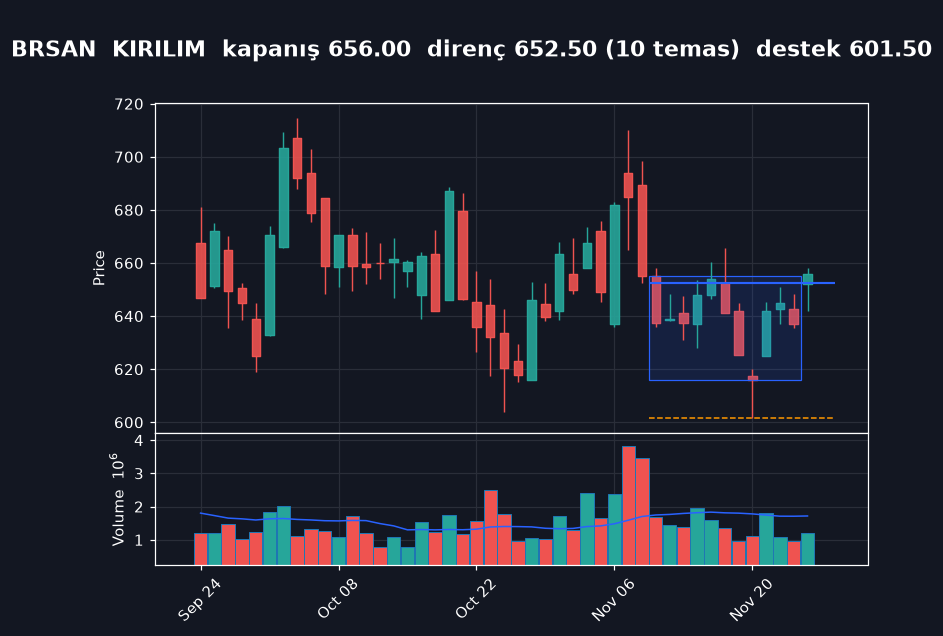

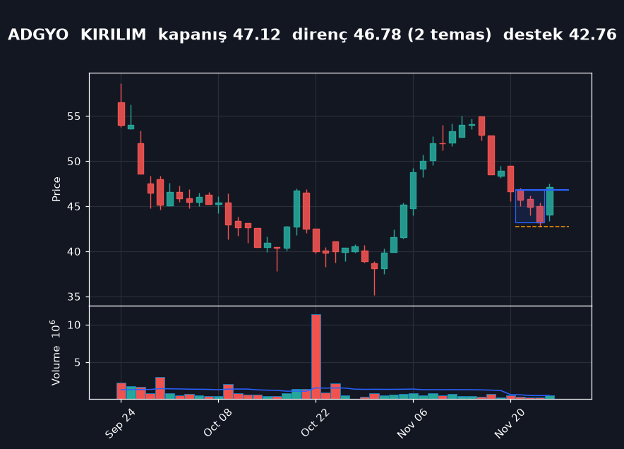

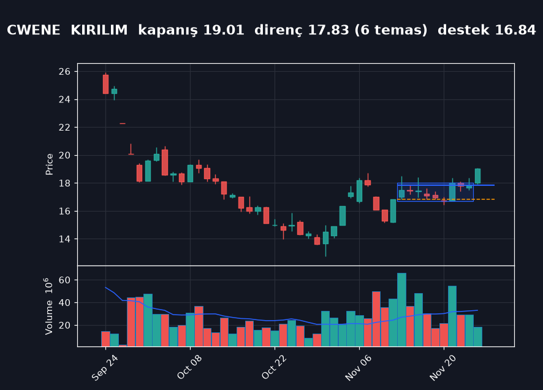

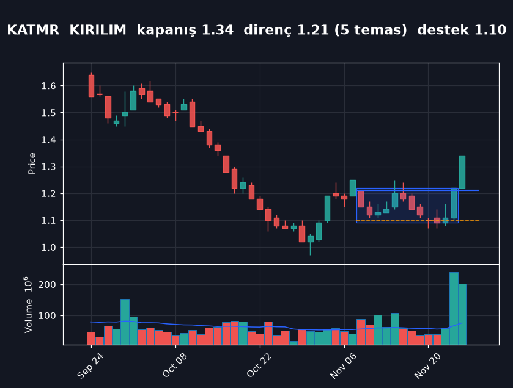
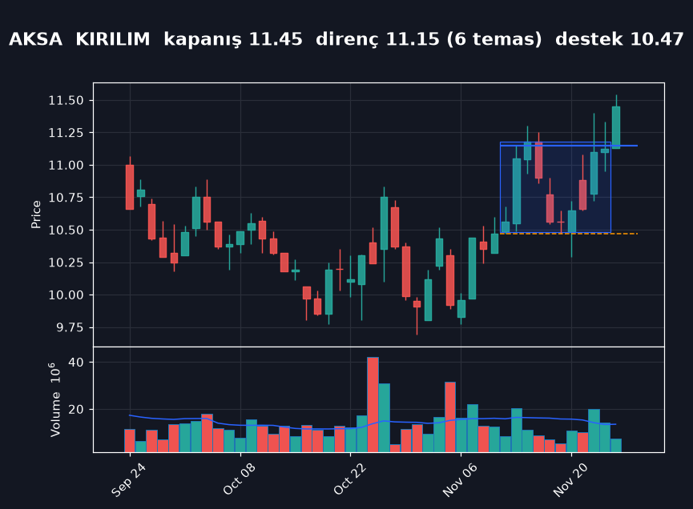
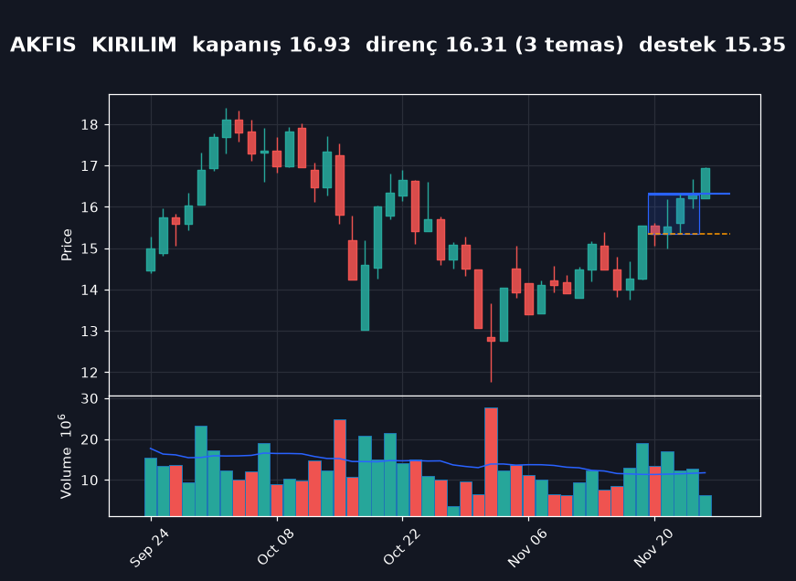

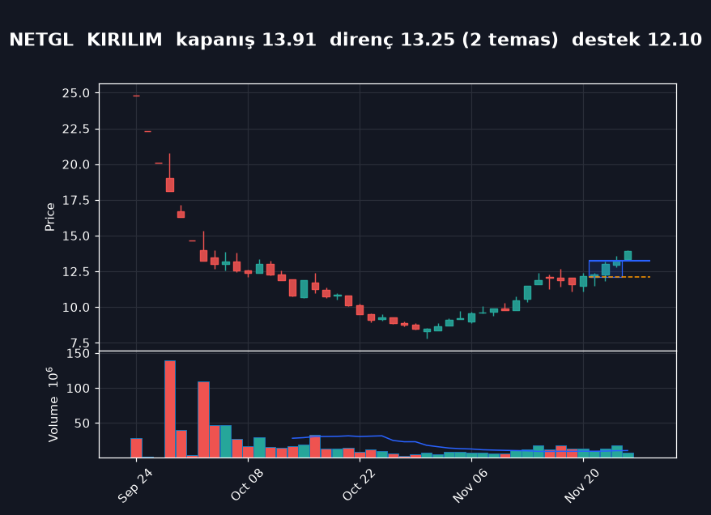

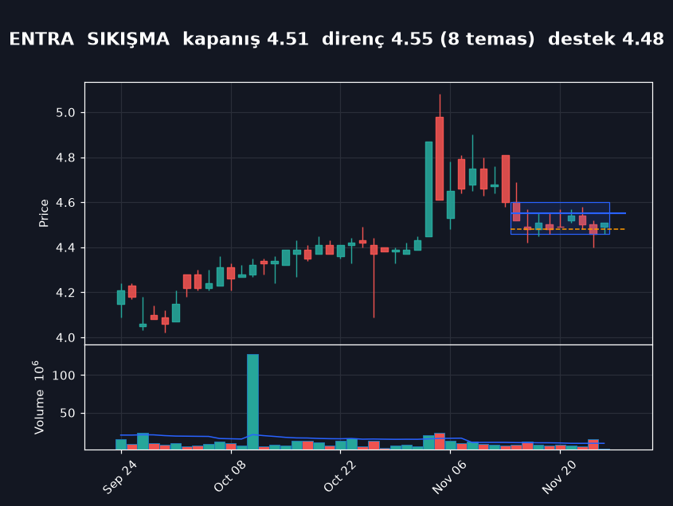
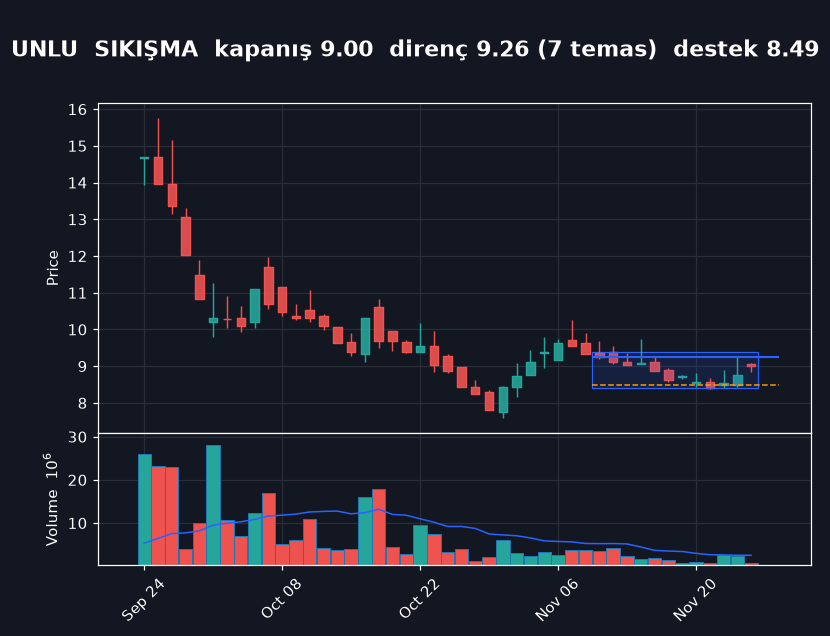

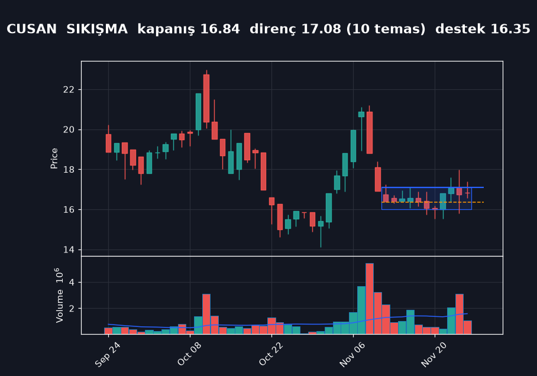
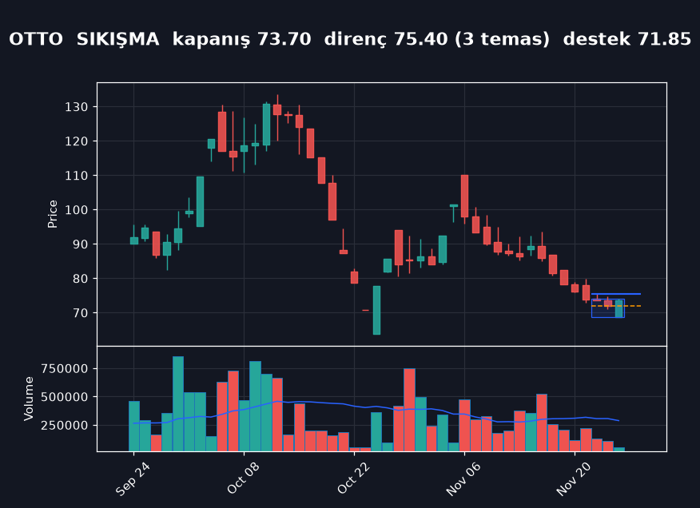
