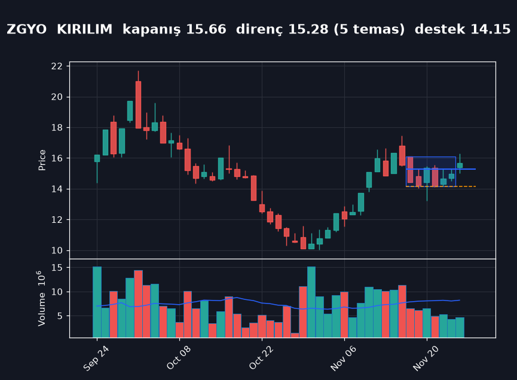
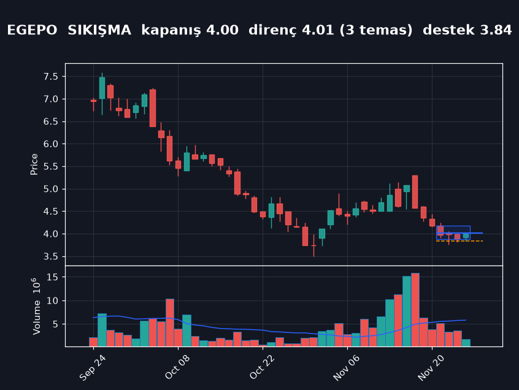
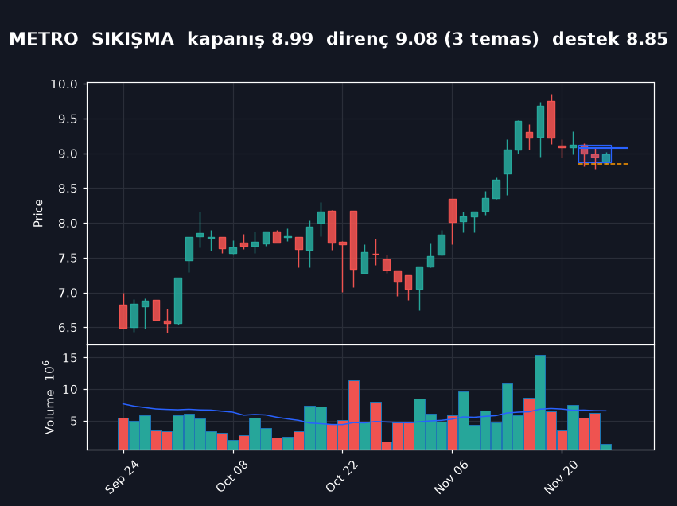
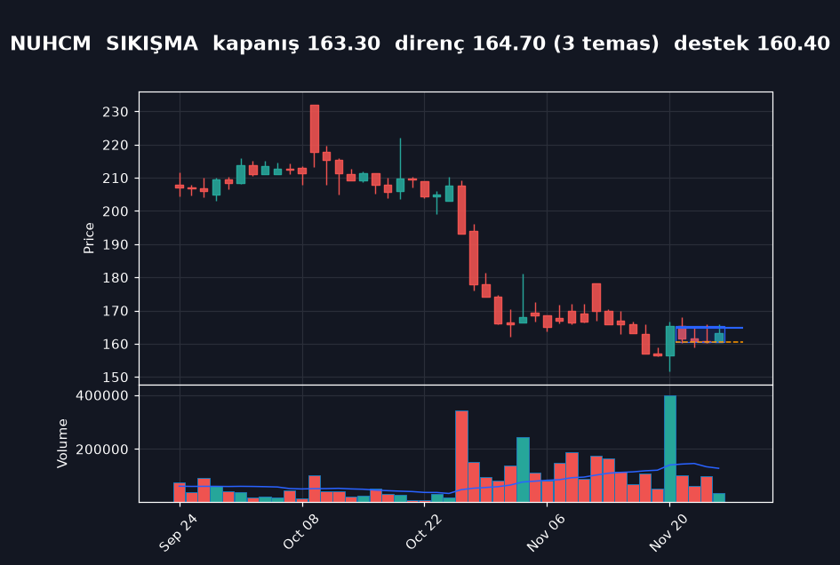
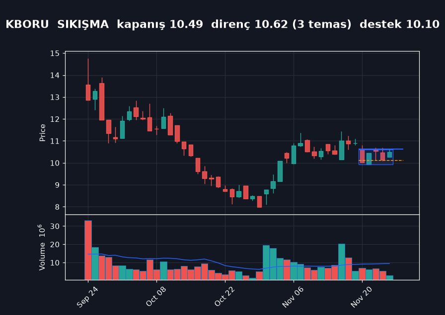
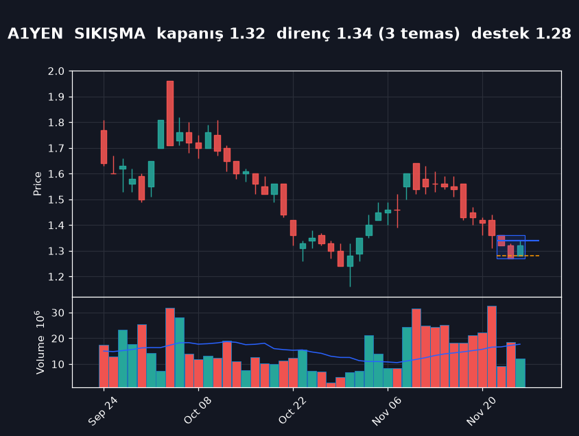
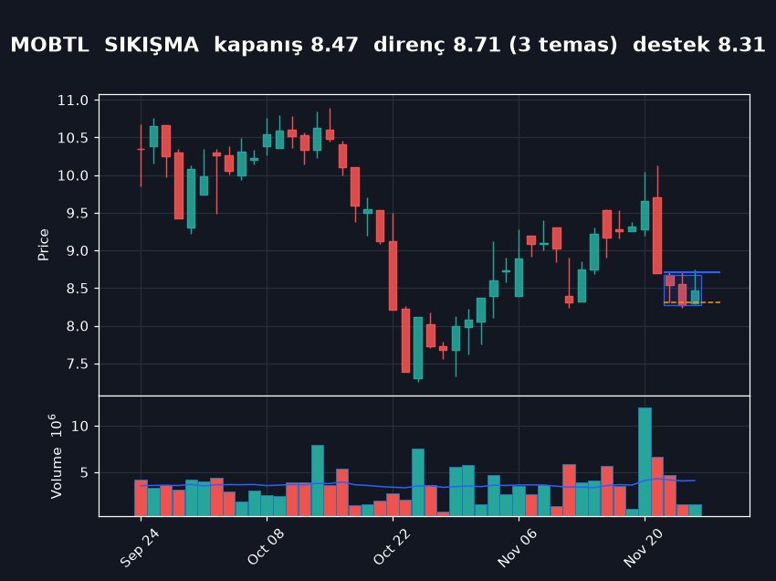

# BIST Sıkışma Taraması — 2026-11-26 14:50

## Bugün kırılım yapanlar (5, en iyi 5 gösteriliyor — tamamı results.csv'de)

| Hisse | Skor | Kapanış | Direnç (temas) | Destek | Dirence % | Risk % | Mum | Hacim/SMA |
|---|---|---|---|---|---|---|---|---|
| ALFAS | 63.0 | 22.16 | 21.92 (3) | 21.46 | -1.08 | 2.1 | 3 | 0.50 |
| ZGYO | 52.2 | 15.66 | 15.28 (5) | 14.15 | -2.43 | 7.4 | 6 | 0.58 |
| CWENE | 51.6 | 18.65 | 18.37 (5) | 16.95 | -1.5 | 7.73 | 9 | 0.79 |
| FZLGY | 36.6 | 7.15 | 6.90 (3) | 6.53 | -3.5 | 5.36 | 4 | 0.95 |
| KRGYO | 32.2 | 3.37 | 3.31 (3) | 3.14 | -1.78 | 5.14 | 4 | 0.51 |

## Sıkışmada (yarın izle) (8, en iyi 8 gösteriliyor — tamamı results.csv'de)

| Hisse | Skor | Kapanış | Direnç (temas) | Destek | Dirence % | Risk % | Mum | Hacim/SMA |
|---|---|---|---|---|---|---|---|---|
| EGEPO | 73.2 | 4.00 | 4.01 (3) | 3.84 | 0.25 | 4.24 | 3 | 0.55 |
| METRO | 65.2 | 8.99 | 9.08 (3) | 8.85 | 1.0 | 2.53 | 3 | 0.65 |
| EGEGY | 65.1 | 18.02 | 18.36 (4) | 17.70 | 1.89 | 3.59 | 5 | 0.68 |
| NUHCM | 63.9 | 163.30 | 164.70 (3) | 160.40 | 0.86 | 2.61 | 4 | 0.53 |
| KBORU | 59.4 | 10.49 | 10.62 (3) | 10.10 | 1.24 | 4.9 | 5 | 0.63 |
| A1YEN | 57.6 | 1.32 | 1.34 (3) | 1.28 | 1.52 | 4.48 | 3 | 0.81 |
| MOBTL | 55.9 | 8.47 | 8.71 (3) | 8.31 | 2.83 | 4.59 | 3 | 0.60 |
| VESTL | 46.0 | 12.57 | 12.91 (2) | 12.03 | 2.7 | 6.82 | 4 | 0.77 |

## Grafikler

