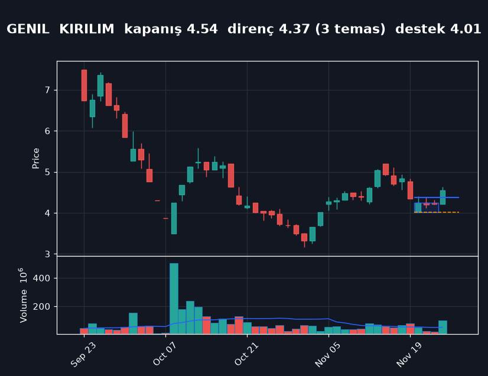
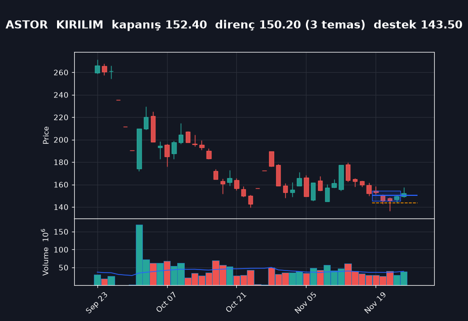
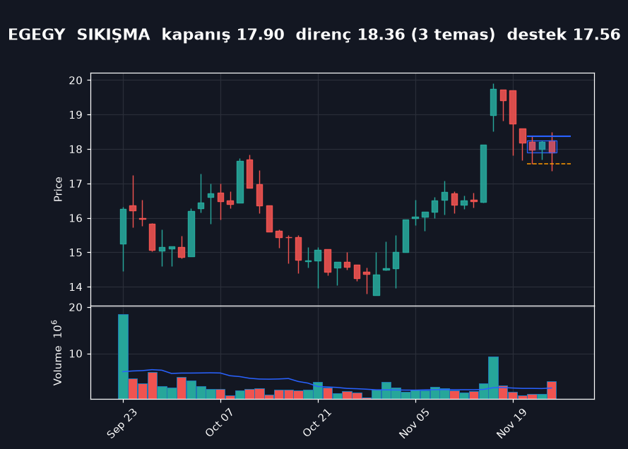

# BIST Sıkışma Taraması — 2026-11-27 02:59

## Bugün kırılım yapanlar (2, en iyi 2 gösteriliyor — tamamı results.csv'de)

| Hisse | Skor | Kapanış | Direnç (temas) | Destek | Dirence % | Risk % | Mum | Hacim/SMA |
|---|---|---|---|---|---|---|---|---|
| GENIL | 67.3 | 4.54 | 4.37 (3) | 4.01 | -3.74 | 8.24 | 3 | 1.97 |
| ASTOR | 66.0 | 152.40 | 150.20 (3) | 143.50 | -1.44 | 4.46 | 4 | 1.02 |

## Sıkışmada (yarın izle) (5, en iyi 5 gösteriliyor — tamamı results.csv'de)

| Hisse | Skor | Kapanış | Direnç (temas) | Destek | Dirence % | Risk % | Mum | Hacim/SMA |
|---|---|---|---|---|---|---|---|---|
| ALFAS | 71.1 | 21.52 | 21.92 (3) | 21.46 | 1.86 | 2.1 | 3 | 0.63 |
| ZGYO | 60.2 | 14.98 | 15.28 (5) | 14.15 | 2.0 | 7.4 | 6 | 0.73 |
| CWENE | 58.4 | 17.80 | 18.37 (5) | 16.95 | 3.2 | 7.73 | 9 | 1.52 |
| EGEGY | 49.3 | 17.90 | 18.36 (3) | 17.56 | 2.57 | 4.36 | 3 | 0.89 |
| KRGYO | 40.7 | 3.26 | 3.31 (3) | 3.14 | 1.53 | 5.14 | 4 | 1.14 |

## Grafikler

