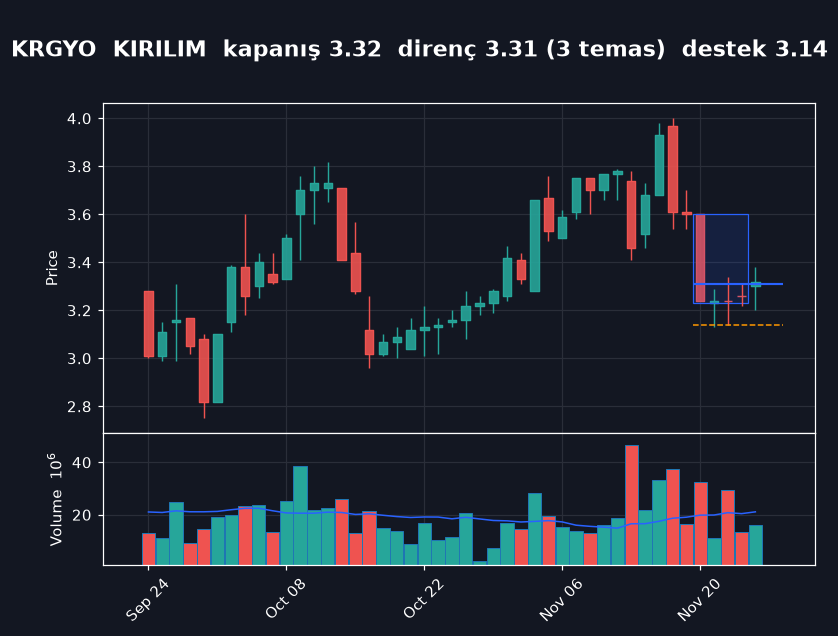
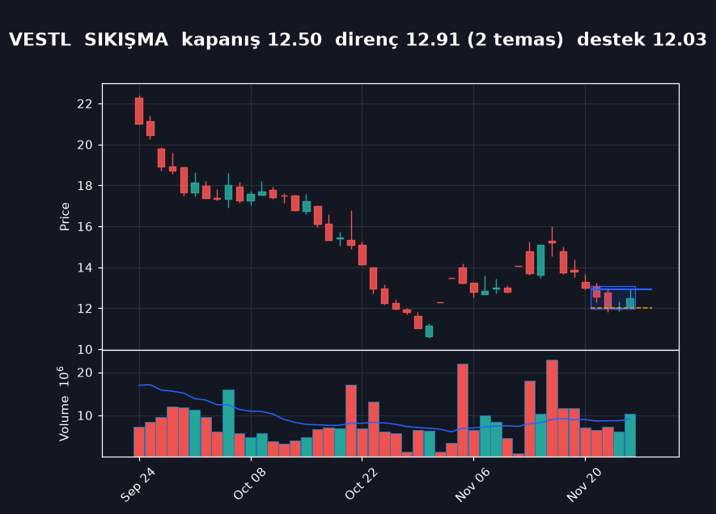
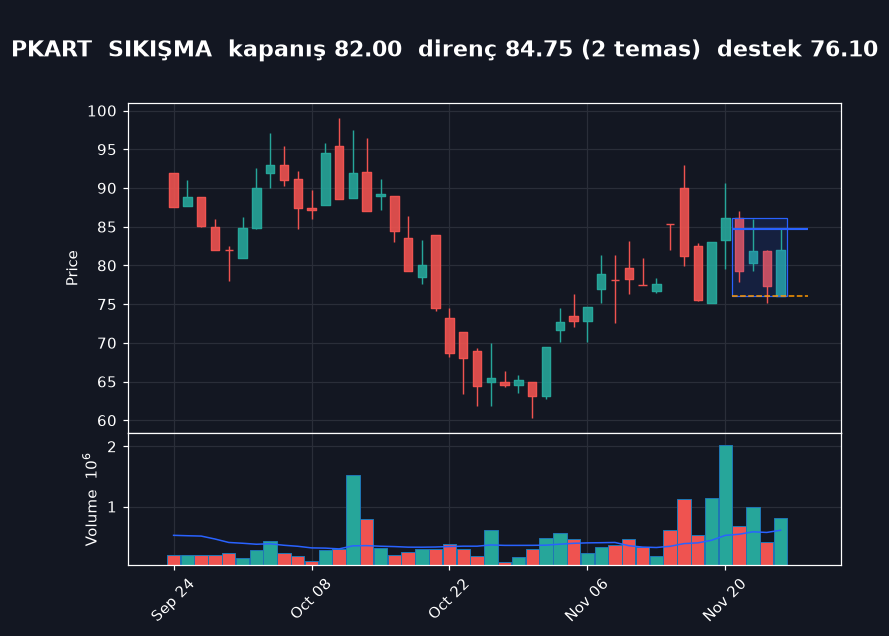

# BIST Sıkışma Taraması — 2026-11-28 02:41

## Bugün kırılım yapanlar (6, en iyi 6 gösteriliyor — tamamı results.csv'de)

| Hisse | Skor | Kapanış | Direnç (temas) | Destek | Dirence % | Risk % | Mum | Hacim/SMA |
|---|---|---|---|---|---|---|---|---|
| CWENE | 71.6 | 18.60 | 18.37 (5) | 16.95 | -1.24 | 7.73 | 9 | 1.20 |
| ALFAS | 63.0 | 21.98 | 21.92 (3) | 21.46 | -0.27 | 2.1 | 3 | 0.75 |
| FZLGY | 56.6 | 7.15 | 6.90 (3) | 6.53 | -3.5 | 5.36 | 4 | 1.15 |
| ZGYO | 52.2 | 16.00 | 15.28 (5) | 14.15 | -4.5 | 7.4 | 6 | 0.86 |
| EGEGY | 41.9 | 18.40 | 18.36 (3) | 17.56 | -0.22 | 4.36 | 3 | 0.88 |
| KRGYO | 32.2 | 3.32 | 3.31 (3) | 3.14 | -0.3 | 5.14 | 4 | 0.79 |

## Sıkışmada (yarın izle) (6, en iyi 6 gösteriliyor — tamamı results.csv'de)

| Hisse | Skor | Kapanış | Direnç (temas) | Destek | Dirence % | Risk % | Mum | Hacim/SMA |
|---|---|---|---|---|---|---|---|---|
| NUHCM | 64.0 | 162.60 | 164.70 (3) | 160.40 | 1.29 | 2.61 | 4 | 0.57 |
| KBORU | 58.6 | 10.51 | 10.62 (3) | 10.10 | 1.05 | 4.9 | 5 | 0.66 |
| MOBTL | 56.8 | 8.59 | 8.71 (3) | 8.31 | 1.4 | 4.59 | 3 | 0.66 |
| A1YEN | 52.8 | 1.31 | 1.34 (3) | 1.28 | 2.29 | 4.48 | 3 | 0.88 |
| VESTL | 43.2 | 12.50 | 12.91 (2) | 12.03 | 3.28 | 6.82 | 4 | 0.84 |
| PKART | 19.8 | 82.00 | 84.75 (2) | 76.10 | 3.35 | 10.21 | 4 | 1.37 |

## Grafikler

