# BIST Sıkışma Taraması — 2026-11-26 12:59

## Bugün kırılım yapanlar (14)

| Hisse | Skor | Kapanış | Direnç (temas) | Destek | Dirence % | Risk % | Mum | Hacim/SMA |
|---|---|---|---|---|---|---|---|---|
| KCAER | 78.8 | 10.64 | 10.28 (11) | 9.90 | -3.38 | 3.7 | 15 | 1.37 |
| BRSAN | 55.3 | 655.50 | 652.50 (10) | 601.50 | -0.46 | 7.82 | 11 | 0.70 |
| KRPLS | 53.4 | 10.58 | 10.40 (3) | 9.88 | -1.7 | 5.0 | 4 | 0.28 |
| ADGYO | 52.6 | 47.12 | 46.78 (2) | 42.76 | -0.72 | 8.59 | 3 | 1.16 |
| ZGYO | 49.2 | 15.93 | 15.55 (5) | 14.15 | -2.39 | 9.0 | 5 | 0.41 |
| IZMDC | 46.9 | 6.14 | 5.93 (11) | 5.60 | -3.42 | 5.56 | 11 | 0.33 |
| CWENE | 46.6 | 19.04 | 17.83 (6) | 16.84 | -6.36 | 5.55 | 9 | 0.56 |
| TGSAS | 44.9 | 112.70 | 112.50 (5) | 100.10 | -0.18 | 11.02 | 6 | 0.59 |
| FZLGY | 43.4 | 7.15 | 6.90 (3) | 6.38 | -3.5 | 7.54 | 3 | 0.94 |
| KATMR | 35.2 | 1.34 | 1.21 (5) | 1.10 | -9.7 | 9.09 | 12 | 3.04 |
| AKSA | 29.1 | 11.46 | 11.15 (6) | 10.47 | -2.71 | 6.1 | 10 | 0.54 |
| AKFIS | 28.1 | 16.91 | 16.31 (3) | 15.35 | -3.55 | 5.89 | 4 | 0.53 |
| SAFKR | 22.1 | 12.86 | 12.82 (2) | 11.31 | -0.31 | 11.78 | 6 | 0.45 |
| NETGL | 2.1 | 13.92 | 13.25 (2) | 12.10 | -4.81 | 8.68 | 3 | 0.69 |

## Sıkışmada (yarın izle) (134)

| Hisse | Skor | Kapanış | Direnç (temas) | Destek | Dirence % | Risk % | Mum | Hacim/SMA |
|---|---|---|---|---|---|---|---|---|
| ALFAS | 70.429 | 22.12 | 22.18 (5) | 21.24 | 0.27 | 4.24 | 6 | 0.59 |
| KRDMB | 70.4 | 42.14 | 42.14 (4) | 39.20 | -0.0 | 6.98 | 4 | 0.25 |
| ENTRA | 69.413 | 4.51 | 4.55 (8) | 4.48 | 0.89 | 1.54 | 9 | 0.70 |
| UNLU | 68.325 | 9.01 | 9.26 (7) | 8.49 | 2.77 | 8.32 | 12 | 0.37 |
| OZYSR | 68.2 | 13.94 | 13.93 (10) | 13.51 | -0.07 | 3.02 | 10 | 0.61 |
| GUBRF | 66.763 | 282.25 | 288.00 (7) | 271.00 | 2.04 | 5.9 | 12 | 0.67 |
| GLRMK | 65.698 | 116.50 | 117.90 (5) | 115.10 | 1.2 | 2.37 | 7 | 0.60 |
| OTTO | 65.67 | 73.90 | 75.40 (3) | 71.85 | 2.03 | 4.71 | 3 | 0.30 |
| DMRGD | 65.289 | 7.18 | 7.31 (11) | 6.96 | 1.81 | 4.79 | 11 | 0.75 |
| CUSAN | 65.273 | 16.79 | 17.08 (10) | 16.35 | 1.73 | 4.27 | 11 | 1.10 |
| GESAN | 64.869 | 30.76 | 31.60 (5) | 30.00 | 2.73 | 5.06 | 6 | 0.45 |
| DURDO | 64.854 | 5.62 | 5.69 (4) | 5.48 | 1.25 | 3.69 | 4 | 0.38 |
| ICUGS | 64.781 | 1.17 | 1.21 (5) | 1.10 | 3.42 | 9.09 | 5 | 0.41 |
| EMKEL | 61.648 | 5.37 | 5.55 (3) | 5.25 | 3.35 | 5.41 | 3 | 0.36 |
| MEGMT | 60.477 | 3.46 | 3.53 (4) | 3.36 | 2.02 | 4.82 | 5 | 0.47 |
| KLYPV | 59.523 | 48.28 | 50.20 (14) | 47.52 | 3.98 | 5.34 | 15 | 0.66 |
| ASTOR | 59.363 | 154.20 | 159.50 (5) | 148.80 | 3.44 | 6.71 | 8 | 0.76 |
| BTCIM | 59.025 | 1.69 | 1.72 (3) | 1.63 | 1.78 | 5.23 | 3 | 0.38 |
| BINBN | 57.371 | 34.52 | 35.60 (3) | 33.48 | 3.13 | 5.96 | 3 | 0.63 |
| EUPWR | 57.342 | 31.28 | 32.08 (4) | 29.44 | 2.56 | 8.23 | 4 | 0.68 |
| KBORU | 55.867 | 10.50 | 10.85 (13) | 10.08 | 3.33 | 7.1 | 15 | 1.03 |
| ARSAN | 55.041 | 2.90 | 2.98 (5) | 2.84 | 2.76 | 4.7 | 7 | 0.69 |
| TUKAS | 54.796 | 1.84 | 1.91 (5) | 1.81 | 3.8 | 5.24 | 9 | 0.63 |
| YAPRK | 54.79 | 7.04 | 7.09 (2) | 6.86 | 0.71 | 3.24 | 3 | 0.42 |
| TAVHL | 54.62 | 283.00 | 292.00 (5) | 280.50 | 3.18 | 3.94 | 6 | 0.69 |
| BALSU | 54.3 | 6.40 | 6.36 (6) | 6.15 | -0.63 | 3.3 | 7 | 0.64 |
| SANFM | 53.638 | 5.20 | 5.25 (9) | 4.90 | 0.96 | 6.67 | 10 | 0.93 |
| UCAYM | 53.511 | 10.66 | 11.00 (3) | 10.58 | 3.19 | 3.82 | 4 | 0.36 |
| MOBTL | 53.5 | 8.52 | 8.75 (3) | 8.24 | 2.7 | 5.83 | 3 | 0.59 |
| GZNMI | 53.182 | 18.32 | 18.36 (3) | 16.66 | 0.22 | 9.26 | 3 | 0.32 |
| AKSGY | 53.052 | 8.44 | 8.52 (5) | 8.27 | 0.95 | 2.93 | 5 | 0.53 |
| BKRGY | 52.804 | 3.77 | 3.80 (2) | 3.65 | 0.8 | 3.95 | 3 | 0.44 |
| TUPRS | 52.4 | 324.00 | 324.00 (4) | 318.00 | 0.0 | 1.85 | 5 | 0.84 |
| CVKMD | 51.444 | 11.09 | 11.44 (5) | 10.93 | 3.16 | 4.46 | 5 | 0.88 |
| FENER | 51.18 | 1.96 | 1.98 (4) | 1.92 | 1.02 | 3.03 | 4 | 0.66 |
| SMRTG | 51.009 | 4.01 | 4.15 (3) | 3.91 | 3.49 | 5.78 | 6 | 0.34 |
| AGESA | 50.979 | 204.10 | 207.00 (6) | 204.80 | 1.42 | 1.06 | 7 | 0.40 |
| YKSLN | 50.81 | 1.73 | 1.78 (3) | 1.68 | 2.89 | 5.62 | 4 | 0.83 |
| HDFGS | 49.896 | 1.08 | 1.12 (4) | 1.01 | 3.7 | 9.82 | 5 | 0.78 |
| KARSN | 49.805 | 7.08 | 7.20 (5) | 6.85 | 1.69 | 4.86 | 6 | 0.56 |
| CITAS | 49.384 | 107.50 | 108.70 (3) | 101.00 | 1.12 | 7.08 | 3 | 0.69 |
| SURGY | 49.056 | 15.33 | 15.49 (3) | 15.14 | 1.04 | 2.26 | 4 | 0.50 |
| GIPTA | 48.804 | 23.68 | 24.20 (3) | 23.56 | 2.2 | 2.64 | 4 | 0.43 |
| IZFAS | 48.615 | 11.55 | 11.71 (4) | 10.39 | 1.39 | 11.27 | 4 | 1.12 |
| ARFYE | 48.432 | 11.31 | 11.51 (5) | 10.30 | 1.77 | 10.51 | 11 | 0.77 |
| BIOEN | 48.339 | 14.37 | 14.58 (6) | 13.14 | 1.46 | 9.88 | 10 | 0.57 |
| AAGYO | 48.093 | 7.18 | 7.36 (3) | 7.02 | 2.51 | 4.62 | 5 | 0.54 |
| SSAAT | 48.079 | 19.72 | 20.02 (3) | 19.34 | 1.52 | 3.4 | 4 | 0.66 |
| ECZYT | 47.738 | 145.00 | 147.70 (4) | 140.00 | 1.86 | 5.21 | 5 | 0.56 |
| MERCN | 47.384 | 3.04 | 3.08 (3) | 2.91 | 1.32 | 5.52 | 4 | 0.49 |
| ISKPL | 47.263 | 2.97 | 2.98 (3) | 2.73 | 0.34 | 8.39 | 4 | 0.67 |
| YUNSA | 47.149 | 6.31 | 6.37 (11) | 5.97 | 0.95 | 6.28 | 15 | 1.10 |
| BESTE | 47.0 | 16.45 | 16.35 (4) | 15.31 | -0.61 | 6.36 | 7 | 0.65 |
| SMRVA | 46.871 | 4.43 | 4.48 (3) | 4.00 | 1.13 | 10.71 | 3 | 0.55 |
| BUCIM | 46.654 | 4.11 | 4.19 (5) | 3.81 | 1.95 | 9.07 | 10 | 0.87 |
| MRGYO | 46.54 | 1.01 | 1.05 (3) | 0.99 | 3.96 | 5.71 | 5 | 0.62 |
| BRKVY | 46.459 | 31.96 | 32.74 (5) | 29.72 | 2.44 | 9.22 | 5 | 1.27 |
| HOROZ | 46.303 | 33.96 | 34.74 (6) | 33.28 | 2.3 | 4.2 | 7 | 0.91 |
| ARASE | 46.0 | 54.05 | 53.55 (5) | 50.95 | -0.93 | 4.86 | 5 | 1.35 |
| LOGO | 45.905 | 115.80 | 117.30 (6) | 111.00 | 1.3 | 5.37 | 7 | 0.85 |
| FORTE | 45.754 | 84.90 | 88.25 (4) | 82.60 | 3.95 | 6.4 | 7 | 0.58 |
| LINK | 45.443 | 2.53 | 2.62 (2) | 2.49 | 3.56 | 4.96 | 6 | 0.52 |
| ATATR | 45.339 | 4.41 | 4.47 (2) | 4.11 | 1.36 | 8.05 | 3 | 0.38 |
| DAPGM | 45.296 | 2.43 | 2.52 (2) | 2.33 | 3.7 | 7.54 | 3 | 0.36 |
| QUAGR | 44.915 | 1.46 | 1.47 (3) | 1.33 | 0.68 | 9.52 | 5 | 0.58 |
| ALBRK | 44.673 | 8.05 | 8.35 (5) | 7.86 | 3.73 | 5.87 | 7 | 0.56 |
| OYAKC | 44.61 | 18.35 | 18.55 (4) | 17.63 | 1.09 | 4.96 | 5 | 0.55 |
| MARTI | 44.587 | 1.03 | 1.06 (3) | 0.98 | 2.91 | 7.55 | 3 | 1.51 |
| RGYAS | 43.845 | 152.10 | 153.40 (2) | 148.80 | 0.85 | 3.0 | 3 | 0.76 |
| GENIL | 43.298 | 4.61 | 4.67 (2) | 4.20 | 1.3 | 10.06 | 4 | 0.81 |
| CELHA | 43.22 | 32.16 | 33.44 (6) | 30.00 | 3.98 | 10.29 | 13 | 0.84 |
| BSOKE | 43.055 | 6.59 | 6.85 (3) | 6.26 | 3.95 | 8.61 | 3 | 0.91 |
| VEYAS | 43.054 | 66.75 | 68.65 (3) | 62.75 | 2.85 | 8.59 | 3 | 0.55 |
| KOCMT | 42.838 | 2.21 | 2.26 (3) | 2.12 | 2.26 | 6.19 | 4 | 0.55 |
| NUHCM | 41.863 | 164.50 | 166.70 (8) | 157.00 | 1.34 | 5.82 | 10 | 1.16 |
| ALTNY | 41.601 | 10.05 | 10.08 (2) | 9.62 | 0.3 | 4.56 | 3 | 0.48 |
| TOASO | 41.123 | 246.40 | 249.30 (11) | 235.30 | 1.18 | 5.62 | 14 | 1.15 |
| GMTAS | 41.0 | 46.68 | 46.20 (5) | 42.20 | -1.03 | 8.66 | 7 | 0.84 |
| DOCO | 40.662 | 12510.00 | 12852.50 (10) | 11502.50 | 2.74 | 10.5 | 15 | 0.73 |
| SDTTR | 40.406 | 9.55 | 9.75 (2) | 9.25 | 2.09 | 5.13 | 3 | 0.54 |
| TCELL | 40.352 | 88.05 | 91.35 (4) | 86.65 | 3.75 | 5.15 | 5 | 0.56 |
| MPARK | 40.034 | 430.25 | 440.00 (4) | 415.25 | 2.27 | 5.62 | 6 | 0.64 |
| BAHKM | 39.969 | 187.80 | 190.30 (6) | 178.00 | 1.33 | 6.46 | 8 | 0.99 |
| ANSGR | 39.86 | 21.32 | 22.16 (4) | 20.62 | 3.94 | 6.95 | 7 | 0.56 |
| HEKTS | 39.701 | 1.54 | 1.56 (4) | 1.45 | 1.3 | 7.05 | 6 | 0.75 |
| BURVA | 39.564 | 211.80 | 219.50 (3) | 198.50 | 3.64 | 9.57 | 3 | 1.16 |
| VERUS | 39.557 | 443.25 | 452.75 (2) | 434.00 | 2.14 | 4.14 | 3 | 0.48 |
| ASELS | 39.314 | 322.25 | 325.75 (4) | 313.75 | 1.09 | 3.68 | 5 | 0.79 |
| MAVI | 38.868 | 32.20 | 32.50 (3) | 31.62 | 0.93 | 2.71 | 4 | 0.74 |
| ALARK | 38.456 | 103.20 | 105.00 (3) | 99.80 | 1.74 | 4.95 | 8 | 0.60 |
| CCOLA | 38.167 | 75.90 | 78.05 (4) | 73.60 | 2.83 | 5.7 | 5 | 0.41 |
| KCHOL | 37.984 | 187.30 | 192.20 (3) | 182.60 | 2.62 | 4.99 | 5 | 0.75 |
| PKART | 37.024 | 81.95 | 82.75 (3) | 75.10 | 0.98 | 9.24 | 3 | 1.02 |
| KOPOL | 36.964 | 2.75 | 2.85 (2) | 2.72 | 3.64 | 4.56 | 5 | 0.44 |
| FONET | 36.741 | 3.87 | 4.00 (3) | 3.61 | 3.36 | 9.75 | 5 | 0.65 |
| AKFYE | 36.658 | 2.65 | 2.72 (2) | 2.56 | 2.64 | 5.88 | 4 | 0.60 |
| AKGRT | 36.377 | 4.30 | 4.43 (2) | 4.19 | 3.02 | 5.42 | 4 | 0.46 |
| IZENR | 36.289 | 3.60 | 3.64 (3) | 3.48 | 1.11 | 4.4 | 4 | 0.47 |
| FRIGO | 36.2 | 2.33 | 2.33 (4) | 2.10 | 0.0 | 9.87 | 15 | 0.99 |
| MAALT | 36.085 | 705.00 | 718.50 (4) | 675.00 | 1.91 | 6.05 | 6 | 0.54 |
| YATAS | 35.928 | 18.65 | 18.85 (2) | 18.01 | 1.07 | 4.46 | 3 | 0.88 |
| CIMSA | 35.8 | 38.40 | 38.40 (3) | 37.16 | 0.0 | 3.23 | 4 | 0.77 |
| BIGEN | 35.53 | 12.66 | 12.96 (2) | 11.67 | 2.37 | 9.95 | 3 | 1.09 |
| KAREL | 35.363 | 3.81 | 3.88 (4) | 3.61 | 1.84 | 6.96 | 5 | 1.22 |
| ARCLK | 34.8 | 62.35 | 62.10 (3) | 60.00 | -0.4 | 3.38 | 4 | 0.50 |
| PETKM | 34.7 | 15.61 | 15.46 (3) | 14.77 | -0.96 | 4.46 | 7 | 0.79 |
| HRKET | 34.031 | 7.44 | 7.46 (2) | 6.99 | 0.27 | 6.3 | 3 | 0.82 |
| EBEBK | 32.851 | 66.95 | 67.05 (3) | 63.80 | 0.15 | 4.85 | 4 | 1.04 |
| BRYAT | 32.319 | 1141.00 | 1183.00 (2) | 1106.00 | 3.68 | 6.51 | 6 | 0.75 |
| AYGAZ | 32.118 | 247.10 | 251.75 (3) | 240.70 | 1.88 | 4.39 | 5 | 0.68 |
| KGYO | 32.1 | 6.68 | 6.68 (3) | 6.38 | 0.0 | 4.49 | 3 | 0.90 |
| TTRAK | 31.392 | 331.25 | 335.25 (5) | 324.50 | 1.21 | 3.21 | 6 | 1.08 |
| KZBGY | 31.1 | 1.08 | 1.08 (3) | 1.04 | -0.0 | 3.7 | 4 | 0.80 |
| ANHYT | 31.084 | 83.60 | 84.70 (2) | 81.90 | 1.32 | 3.31 | 3 | 0.70 |
| MOPAS | 30.959 | 13.77 | 14.23 (2) | 13.34 | 3.34 | 6.25 | 4 | 0.53 |
| GARAN | 30.893 | 140.90 | 145.70 (5) | 137.90 | 3.41 | 5.35 | 6 | 0.89 |
| DOHOL | 30.876 | 15.20 | 15.31 (2) | 14.86 | 0.72 | 2.94 | 3 | 0.74 |
| MASFN | 30.793 | 28.32 | 29.20 (2) | 27.70 | 3.11 | 5.14 | 3 | 0.52 |
| EUREN | 30.476 | 2.27 | 2.35 (2) | 2.20 | 3.52 | 6.38 | 5 | 0.46 |
| MERIT | 29.449 | 10.89 | 10.95 (2) | 10.40 | 0.55 | 5.02 | 4 | 0.41 |
| SISE | 28.581 | 31.34 | 31.44 (2) | 30.22 | 0.32 | 3.88 | 3 | 0.76 |
| GLYHO | 28.261 | 14.83 | 15.34 (3) | 14.63 | 3.44 | 4.63 | 6 | 0.81 |
| ENKAI | 27.656 | 77.40 | 78.75 (2) | 75.90 | 1.74 | 3.62 | 6 | 0.66 |
| OTKAR | 27.111 | 307.00 | 308.50 (2) | 294.50 | 0.49 | 4.54 | 4 | 0.67 |
| KRDMD | 26.81 | 35.88 | 36.02 (2) | 34.28 | 0.39 | 4.83 | 3 | 0.56 |
| NTHOL | 25.092 | 33.20 | 33.90 (2) | 32.30 | 2.11 | 4.72 | 3 | 0.57 |
| TRALT | 19.847 | 33.48 | 34.00 (2) | 31.98 | 1.55 | 5.94 | 3 | 0.73 |
| ENJSA | 19.489 | 107.40 | 111.60 (2) | 104.40 | 3.91 | 6.45 | 4 | 0.78 |
| SASA | 18.145 | 1.46 | 1.49 (2) | 1.39 | 2.05 | 6.71 | 6 | 1.46 |
| TABGD | 17.591 | 173.00 | 174.40 (2) | 165.60 | 0.81 | 5.05 | 3 | 0.44 |
| HLGYO | 17.296 | 3.33 | 3.45 (3) | 3.23 | 3.6 | 6.38 | 5 | 0.67 |
| TRGYO | 3.249 | 83.00 | 85.20 (4) | 80.10 | 2.65 | 5.99 | 7 | 1.99 |
| REEDR | -5.473 | 2.20 | 2.25 (2) | 2.01 | 2.27 | 10.67 | 3 | 1.82 |
| HUNER | -5.645 | 3.39 | 3.50 (2) | 3.30 | 3.24 | 5.71 | 4 | 1.36 |

## Grafikler

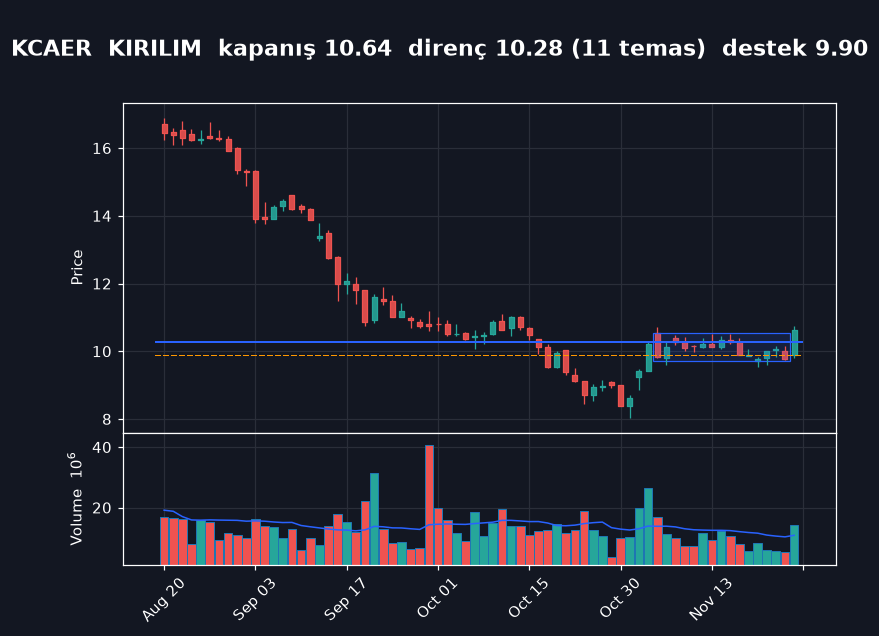

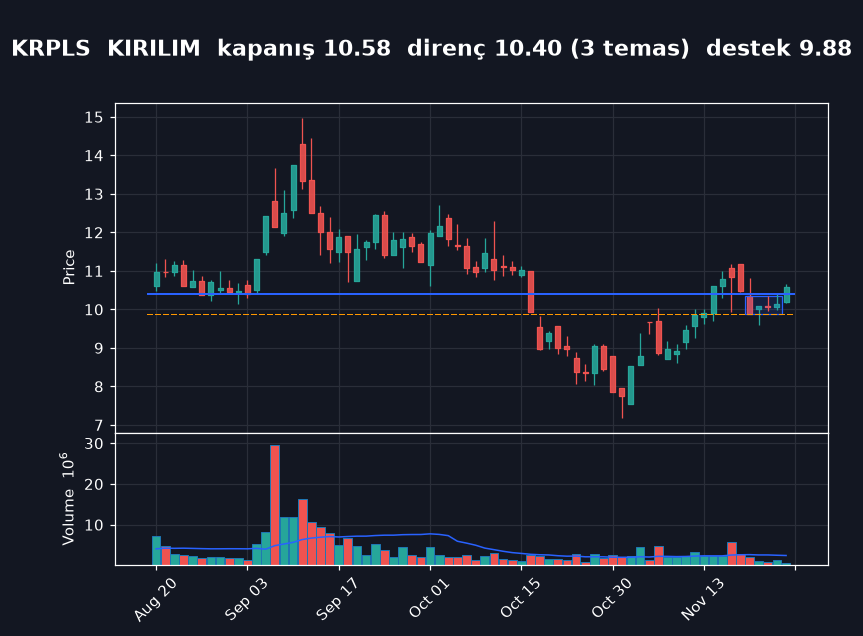

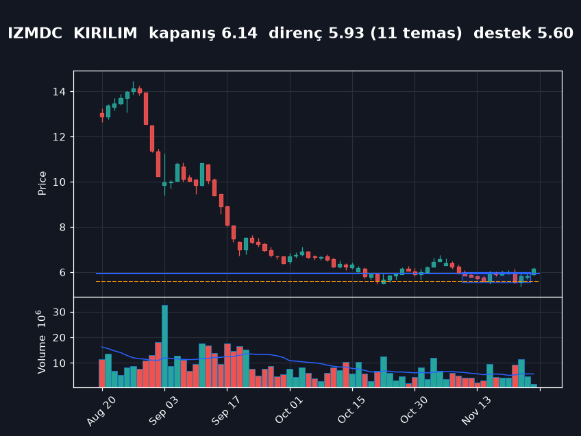

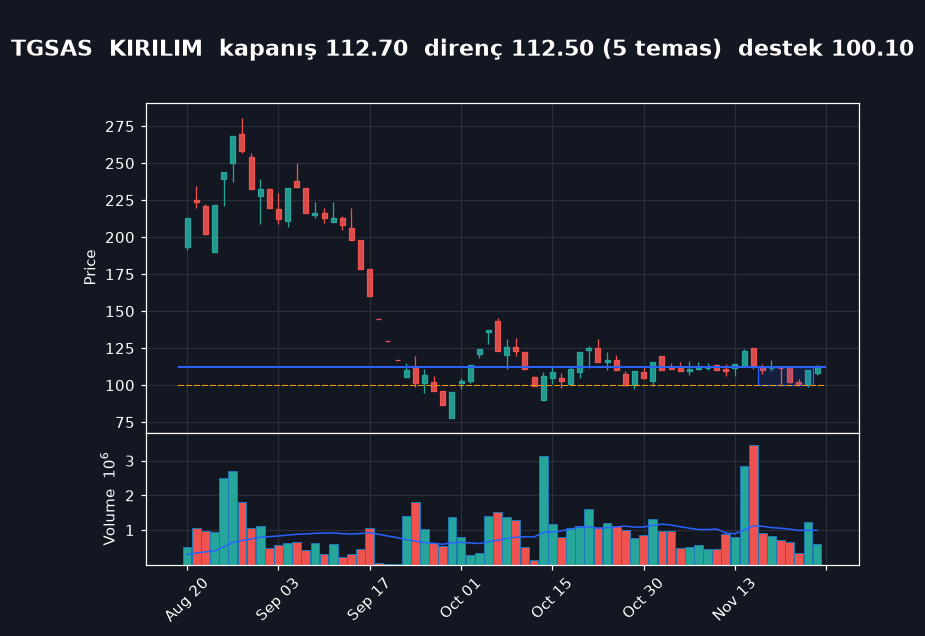
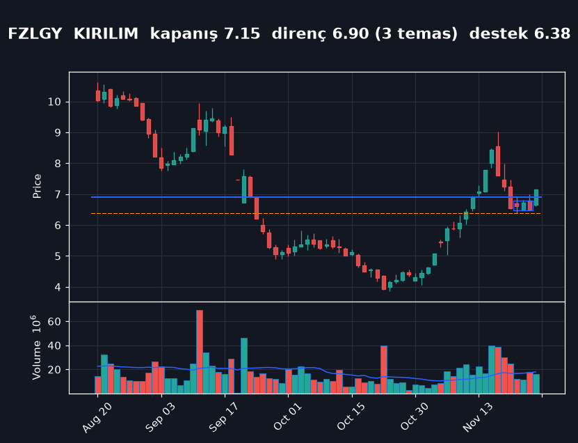

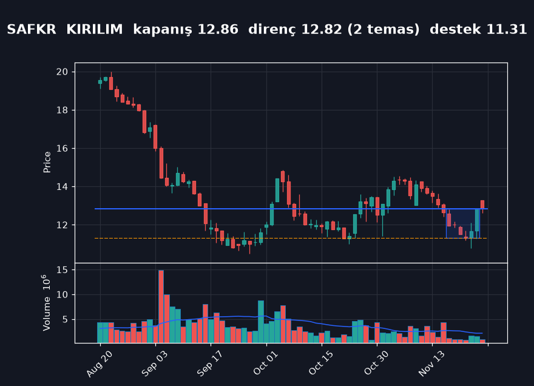

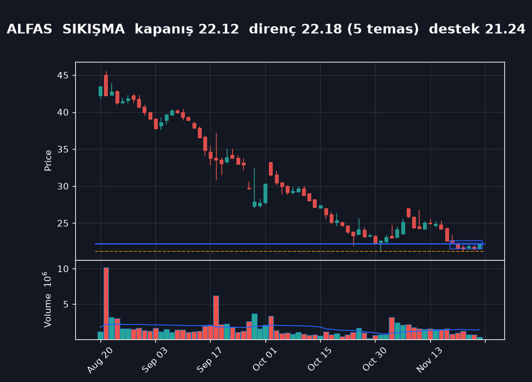
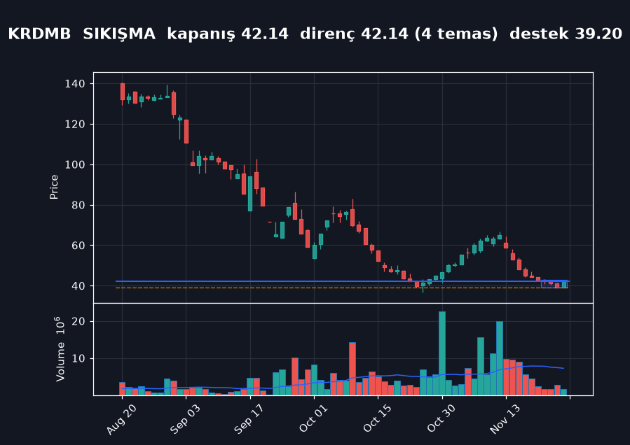

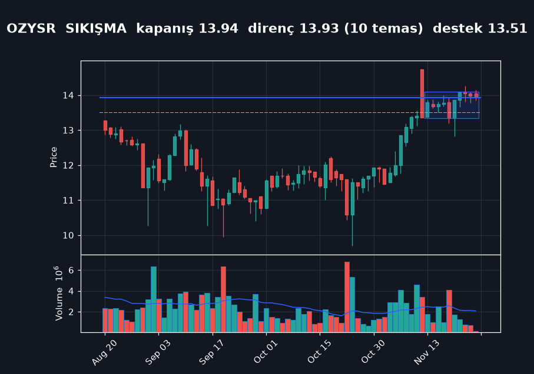
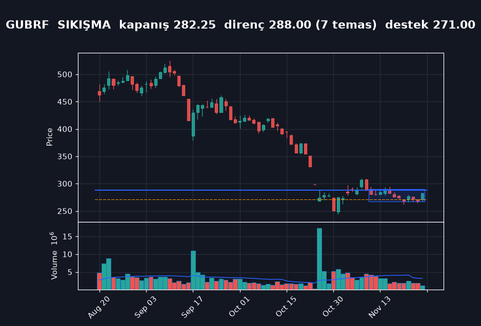
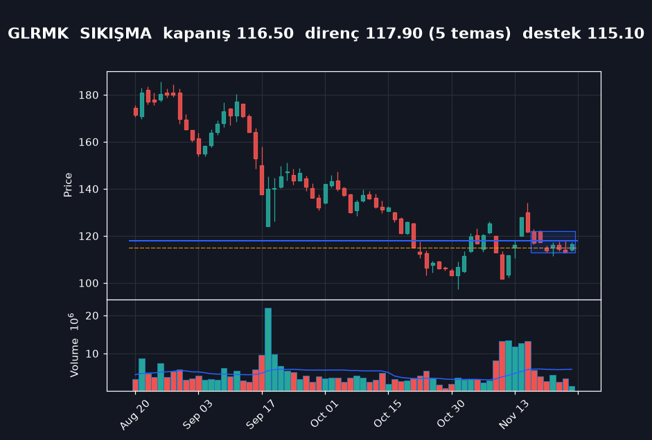

