# BIST Sıkışma Taraması — 2026-11-26 13:31

## Bugün kırılım yapanlar (6, en iyi 6 gösteriliyor — tamamı results.csv'de)

| Hisse | Skor | Kapanış | Direnç (temas) | Destek | Dirence % | Risk % | Mum | Hacim/SMA |
|---|---|---|---|---|---|---|---|---|
| ALFAS | 60.0 | 22.14 | 21.92 (3) | 21.50 | -0.99 | 1.92 | 4 | 0.34 |
| ZGYO | 52.2 | 15.73 | 15.28 (5) | 14.15 | -2.86 | 7.4 | 6 | 0.50 |
| CWENE | 51.6 | 18.71 | 18.37 (5) | 16.95 | -1.82 | 7.73 | 9 | 0.68 |
| TMPOL | 46.7 | 73.50 | 73.30 (3) | 66.85 | -0.27 | 8.8 | 4 | 0.74 |
| PETKM | 46.2 | 15.59 | 15.12 (2) | 14.68 | -3.01 | 2.91 | 4 | 0.61 |
| FZLGY | 36.6 | 7.15 | 6.90 (3) | 6.53 | -3.5 | 5.36 | 4 | 0.94 |

## Sıkışmada (yarın izle) (43, en iyi 40 gösteriliyor — tamamı results.csv'de)

| Hisse | Skor | Kapanış | Direnç (temas) | Destek | Dirence % | Risk % | Mum | Hacim/SMA |
|---|---|---|---|---|---|---|---|---|
| ENTRA | 79.5 | 4.51 | 4.55 (8) | 4.45 | 0.89 | 2.2 | 9 | 0.70 |
| DMRGD | 77.8 | 7.17 | 7.31 (8) | 6.79 | 1.95 | 7.11 | 10 | 0.76 |
| DOAS | 75.9 | 113.40 | 113.60 (4) | 111.20 | 0.18 | 2.11 | 5 | 0.53 |
| ULUUN | 71.0 | 5.59 | 5.60 (2) | 5.50 | 0.18 | 1.79 | 4 | 0.54 |
| BRLSM | 70.8 | 7.83 | 7.83 (3) | 7.69 | 0.0 | 1.79 | 4 | 0.42 |
| TCKRC | 67.8 | 119.40 | 119.60 (2) | 116.30 | 0.17 | 2.76 | 4 | 0.53 |
| EGPRO | 66.7 | 31.92 | 32.04 (3) | 31.66 | 0.38 | 1.19 | 4 | 0.74 |
| EGEPO | 66.6 | 4.00 | 4.01 (3) | 3.84 | 0.25 | 4.24 | 4 | 0.65 |
| RTALB | 65.4 | 1.80 | 1.83 (3) | 1.76 | 1.67 | 3.83 | 3 | 0.27 |
| BALSU | 65.2 | 6.44 | 6.45 (4) | 6.10 | 0.16 | 5.43 | 7 | 0.65 |
| ONCSM | 64.4 | 93.30 | 94.75 (3) | 91.25 | 1.55 | 3.69 | 4 | 0.44 |
| METRO | 63.9 | 8.97 | 9.08 (3) | 8.85 | 1.23 | 2.53 | 3 | 0.64 |
| GESAN | 63.6 | 31.00 | 31.04 (3) | 29.66 | 0.13 | 4.45 | 3 | 0.39 |
| BJKAS | 63.3 | 1.16 | 1.16 (4) | 1.11 | 0.0 | 4.31 | 5 | 0.68 |
| MRGYO | 62.7 | 1.00 | 1.03 (2) | 0.99 | 3.0 | 3.88 | 3 | 0.60 |
| TATGD | 61.5 | 13.55 | 13.67 (3) | 13.33 | 0.89 | 2.49 | 4 | 0.43 |
| DGNMO | 61.0 | 6.25 | 6.48 (2) | 6.09 | 3.68 | 6.02 | 5 | 0.29 |
| KONYA | 60.8 | 2817.50 | 2832.50 (3) | 2767.50 | 0.53 | 2.29 | 4 | 0.71 |
| KBORU | 59.6 | 10.51 | 10.62 (3) | 10.10 | 1.05 | 4.9 | 5 | 0.61 |
| MOBTL | 59.3 | 8.54 | 8.71 (3) | 8.31 | 1.99 | 4.59 | 3 | 0.60 |
| ICUGS | 57.6 | 1.19 | 1.23 (2) | 1.12 | 3.36 | 8.94 | 5 | 0.42 |
| CUSAN | 57.2 | 16.78 | 17.35 (3) | 15.78 | 3.4 | 9.05 | 10 | 0.97 |
| A1YEN | 56.7 | 1.33 | 1.34 (3) | 1.28 | 0.75 | 4.48 | 3 | 0.76 |
| ORZAX | 56.0 | 67.50 | 69.65 (3) | 63.45 | 3.19 | 8.9 | 10 | 0.77 |
| BIOEN | 55.5 | 14.30 | 14.58 (5) | 13.80 | 1.96 | 5.35 | 6 | 0.55 |
| KRPLS | 55.5 | 10.61 | 10.67 (2) | 9.98 | 0.57 | 6.47 | 6 | 0.59 |
| YKSLN | 54.7 | 1.73 | 1.76 (3) | 1.68 | 1.73 | 4.55 | 3 | 0.90 |
| ASTOR | 54.5 | 153.70 | 156.30 (3) | 143.50 | 1.69 | 8.19 | 6 | 0.80 |
| ENKAI | 52.6 | 77.70 | 77.70 (2) | 75.95 | 0.0 | 2.25 | 4 | 0.65 |
| ADEL | 51.5 | 19.23 | 19.98 (2) | 18.78 | 3.9 | 6.01 | 5 | 0.40 |
| TTRAK | 51.4 | 330.25 | 333.50 (5) | 324.50 | 0.98 | 2.7 | 6 | 1.08 |
| IZFAS | 50.8 | 11.13 | 11.37 (3) | 10.75 | 2.16 | 5.45 | 4 | 1.16 |
| KRGYO | 50.1 | 3.29 | 3.30 (4) | 3.14 | 0.3 | 4.85 | 5 | 0.98 |
| TUPRS | 50.1 | 325.25 | 327.25 (2) | 317.00 | 0.61 | 3.13 | 5 | 0.85 |
| ARSAN | 49.1 | 2.90 | 2.95 (2) | 2.84 | 1.72 | 3.73 | 3 | 0.78 |
| GRSEL | 49.0 | 240.50 | 242.00 (4) | 234.70 | 0.62 | 3.02 | 5 | 1.28 |
| ARFYE | 48.8 | 11.26 | 11.46 (3) | 10.90 | 1.78 | 4.89 | 4 | 0.56 |
| EGEGY | 48.7 | 18.19 | 18.60 (2) | 17.70 | 2.25 | 4.84 | 6 | 0.62 |
| NUHCM | 48.3 | 164.00 | 166.00 (4) | 160.30 | 1.22 | 3.43 | 5 | 1.14 |
| VEYAS | 45.4 | 66.60 | 68.65 (2) | 63.70 | 3.08 | 7.21 | 3 | 0.56 |

## Grafikler

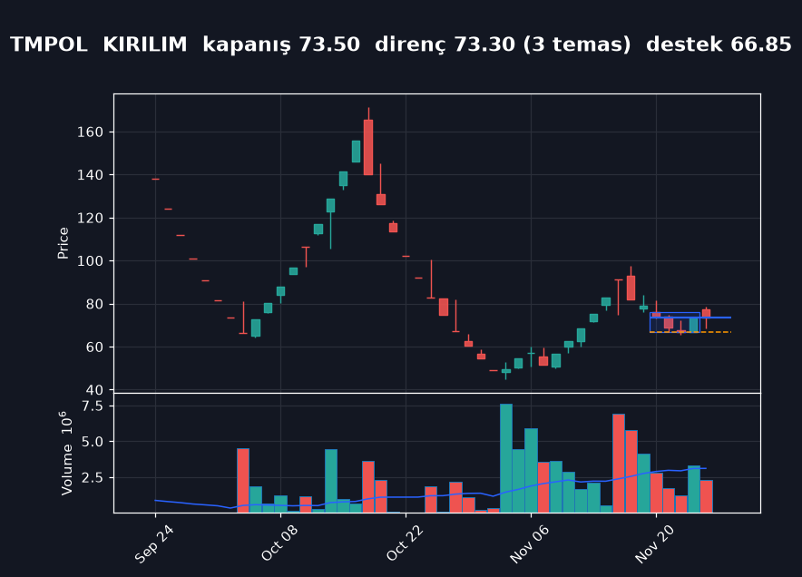
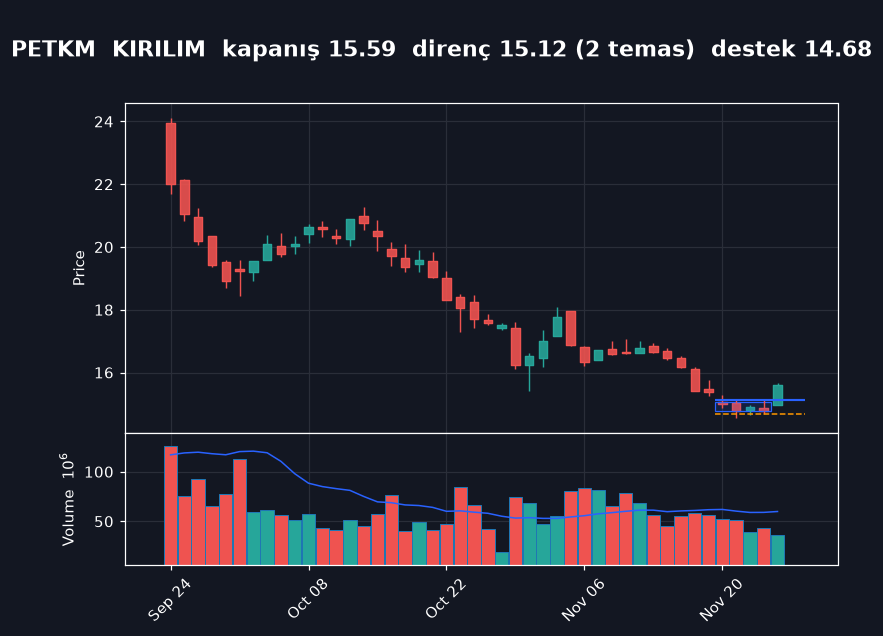

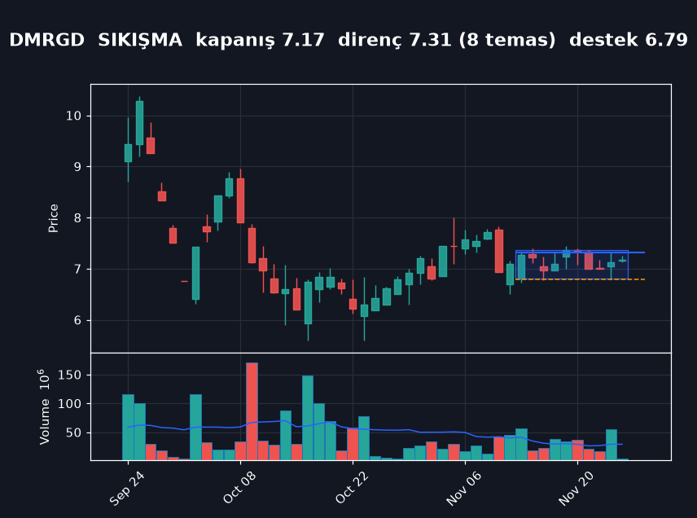
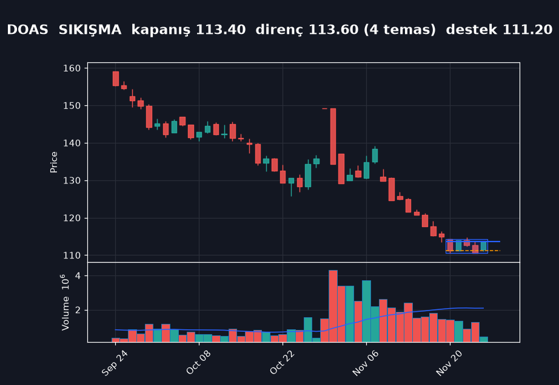
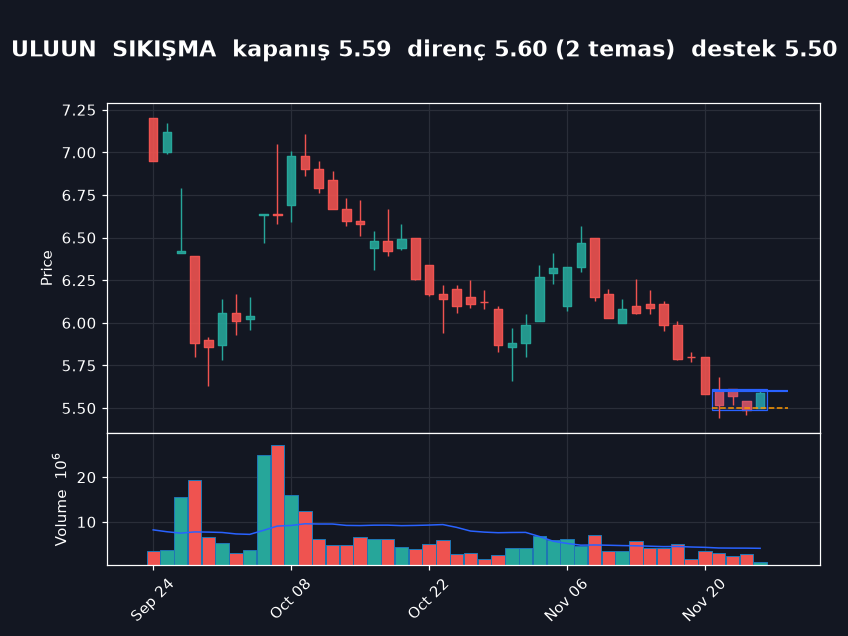
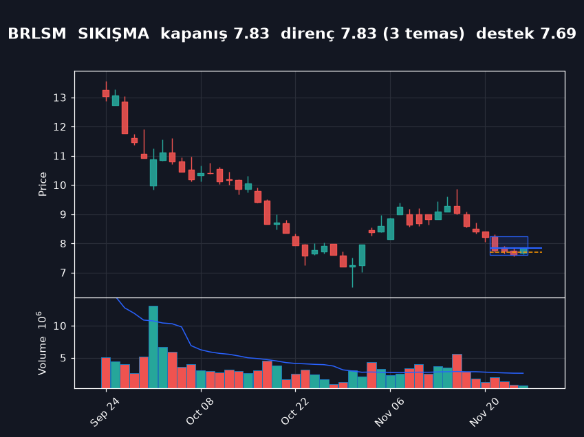
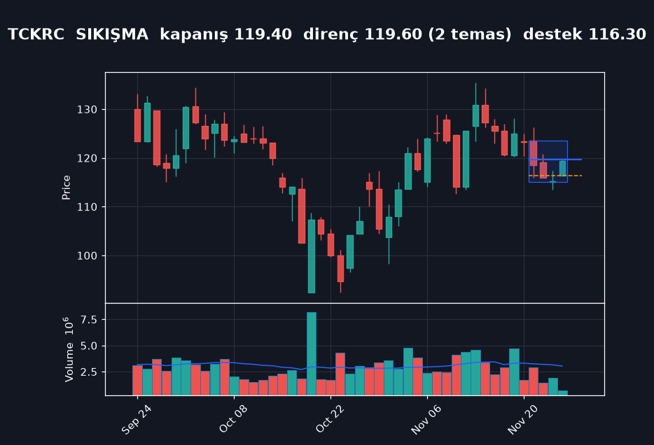
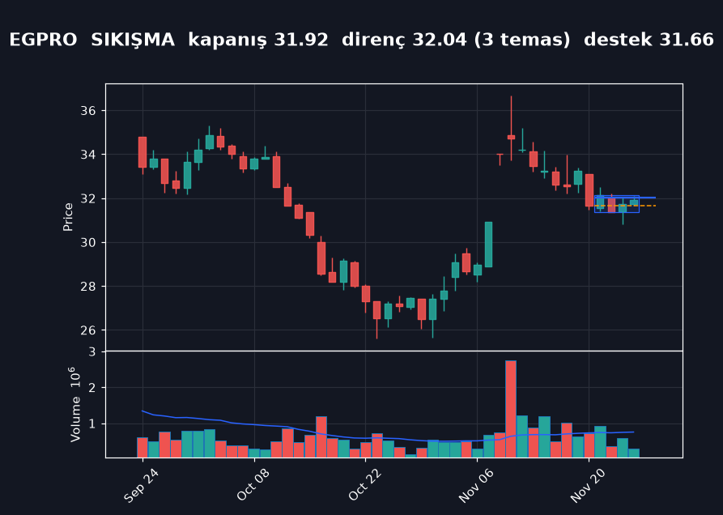

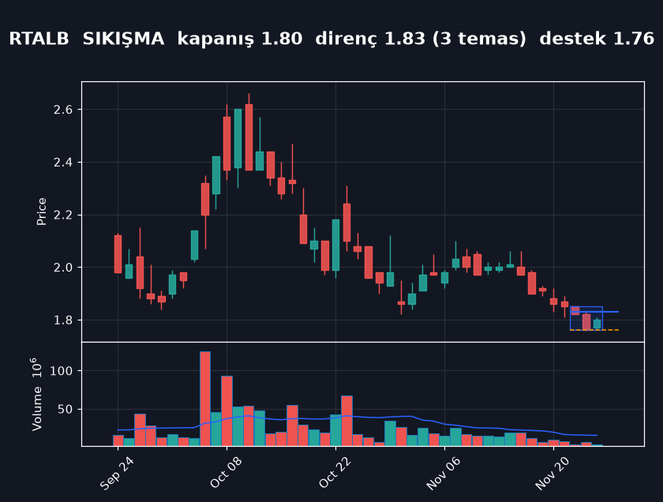
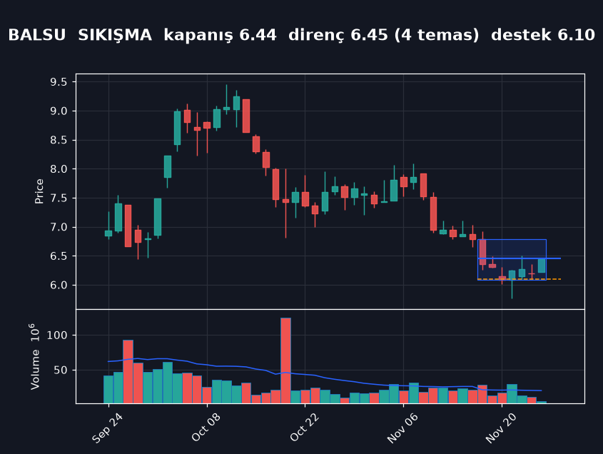
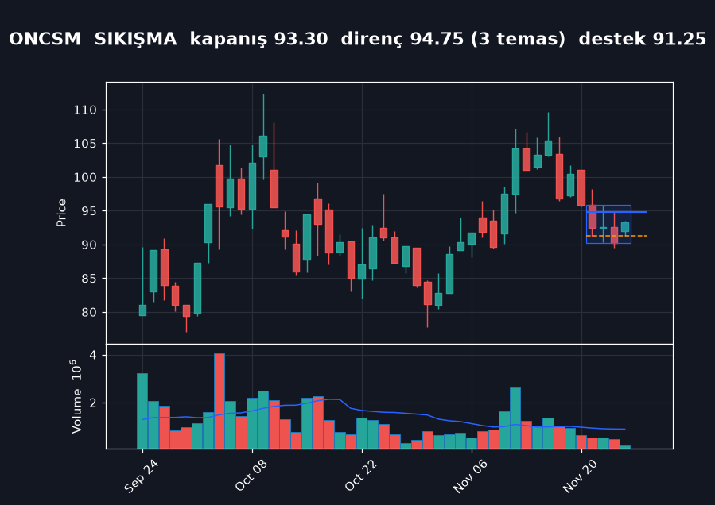

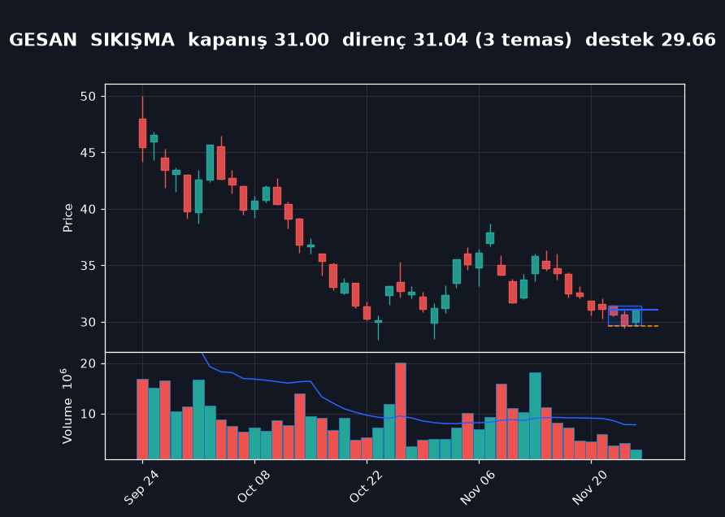
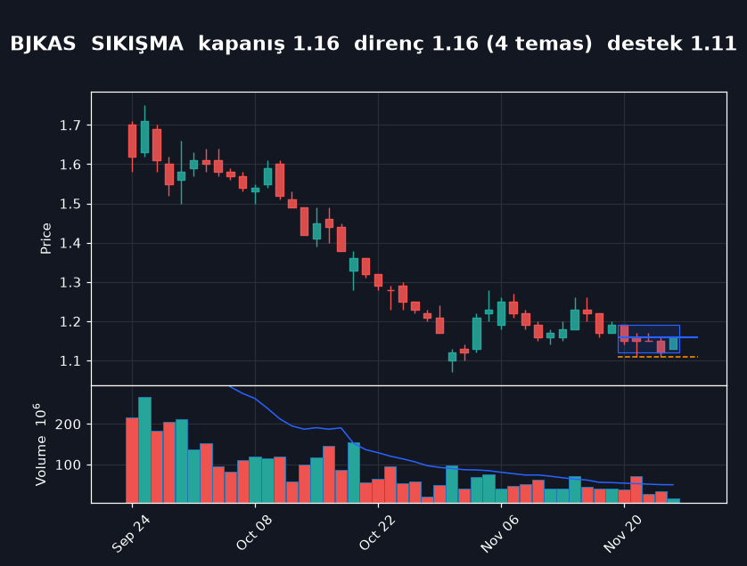
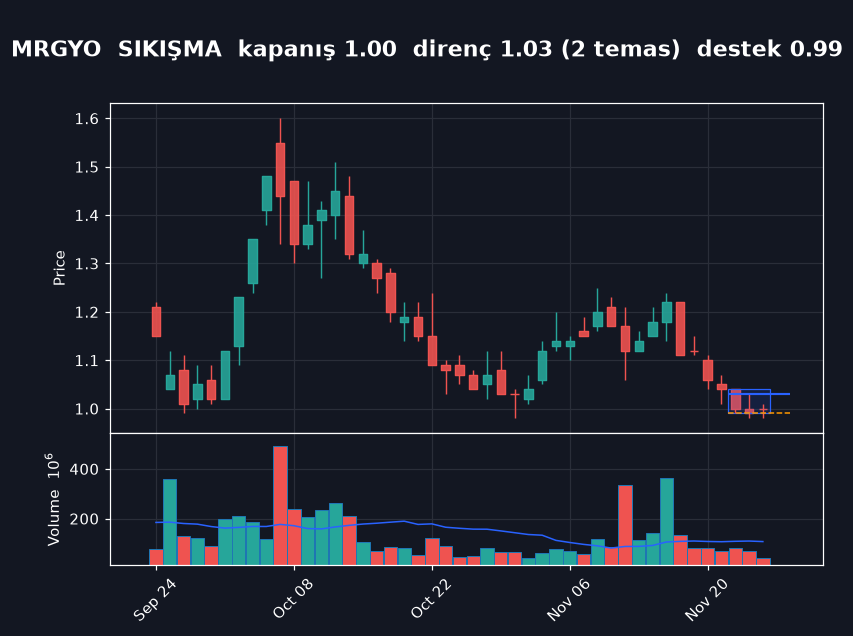
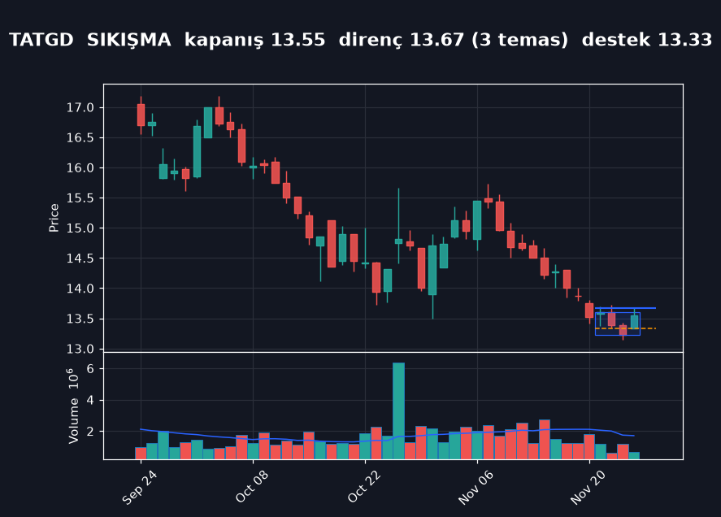
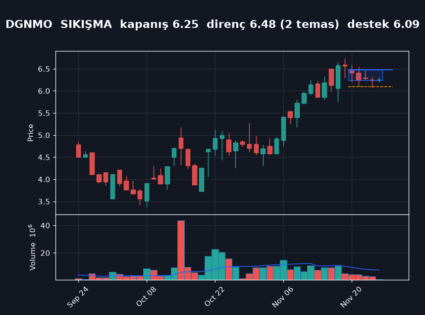
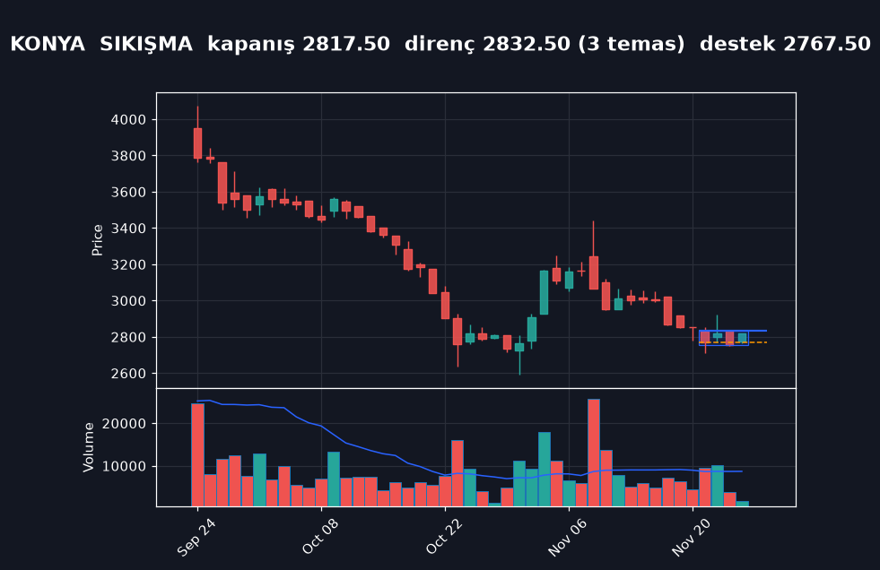
